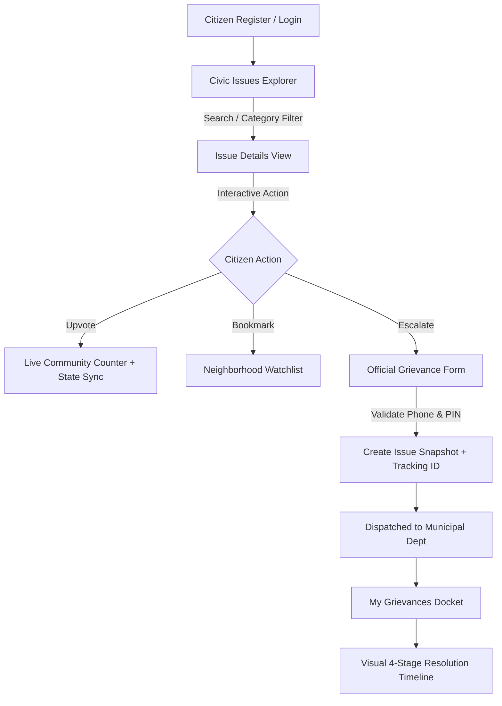

# 🏛️ FixMyCity — Community Grievance & Civic Issue Resolution Platform

> An end-to-end full-stack MERN application connecting proactive citizens with municipal public works departments to report localized civic infrastructure problems, mobilize neighborhood upvotes, and track SLA-backed grievance resolutions through transparent lifecycles.

---

## 🎯 1. Problem Statement

In metropolitan and suburban neighborhoods, civic infrastructure breakdowns—such as dangerous asphalt craters, leaking clean water mains, overflowing waste bins, and broken streetlights—frequently go unresolved because:
1. **Black-box Reporting:** Citizens file complaints via disjointed phone helplines or localized messaging groups with zero visibility into status or assigned officers.
2. **Duplicate Complaints & Disorganization:** Multiple residents report the exact same pothole without knowing someone else already flagged it.
3. **No Community Prioritization:** Municipal ward offices cannot distinguish between a minor aesthetic issue and an acute public safety hazard impacting hundreds of daily commuters.
4. **Lack of SLA Accountability:** Citizens have no historical record or tracking number to hold public works departments accountable.

---

## 👥 2. Target Users

1. **Daily Citizens & Commuters:** Easily report hazards encountered on foot or during daily drives with real photos, track neighborhood repairs, and upvote existing issues.
2. **Resident Welfare Associations (RWAs) & Communities:** Bookmark and monitor clusters of civic problems across their neighborhood ward.
3. **Municipal Ward Engineers & Grievance Desks:** View prioritized community dockets, update progress (`INSPECTION_SCHEDULED` ➔ `WORK_IN_PROGRESS` ➔ `RESOLVED`), and publish resolution notes with photos.

---

## 💡 3. Solution & Product Philosophy

FixMyCity replaces bureaucratic opacity with a transparent 4-stage civic lifecycle:
- **Spot & Document:** Citizens capture problems with photos, categorical classification, and landmark geolocation.
- **Community Validation:** Neighbors upvote urgent hazards and add them to their personalized Watchlist.
- **Official Grievance Escalation:** Verified complainants escalate hazards into formal SLA-backed municipal tickets (`FMC-YYYY-XXXXX`) assigned to specific departments (PWD, Solid Waste Management, Water Board).
- **Verified Closure:** Municipal work updates and engineer logs are displayed in real-time until final verification and resolution.

---

## ✨ 4. Key Workflows & Features



### Workflow 1: Secure Citizen Authentication & Profile Management
- Citizen registration with validation (unique email, minimum 6-character password, 10-digit phone).
- Passwords stored strictly as **bcrypt hashes** (salt rounds = 10).
- Stateless JWT issuance stored inside **HttpOnly cookies** (XSS protection).
- Protected `/citizens/me` profile route with activity metrics and password change functionality.

### Workflow 2: Dynamic Civic Catalog & Real-Time Discovery
- Browse issues with dynamic query search across title, description, or landmarks.
- Instant category filtering: *Roads & Potholes, Sanitation & Waste, Water Supply, Street Lighting, Drainage & Sewage, Parks & Public Spaces, Traffic & Signals*.
- Multi-dimensional filters for **Priority** (*CRITICAL, HIGH, MEDIUM, LOW*) and **Status** (*REPORTED, ACKNOWLEDGED, IN_PROGRESS, RESOLVED*).
- Dynamic sorting by Newest, Most Upvoted, or Oldest.
- Resilient UI handling: Loading skeleton state, Error state with retry action, and Empty state with filter reset.

### Workflow 3: Neighborhood Watchlist (MongoDB Relationships)
- Follow localized problems to monitor municipal progress.
- Modeled using MongoDB `ref: "Issue"` reference arrays with Mongoose `populate()`.
- Server-side duplicate prevention (`409 Conflict`).
- Dedicated `/watchlist` view with one-click remove and dynamic Navbar badge updates.

### Workflow 4: Community Upvotes & Global State Management
- React Context API (`AppContext`) managing upvoted sets and watchlist items.
- Upvote mutations update backend counters and synchronize card buttons across the app in real time without full-page reloads.

### Workflow 5: Official Grievance Escalation & Historical Snapshotting
- Converts an open civic problem into an official SLA-bound administrative ticket.
- **Client & Server-Side Form Validation:** Strict checks for non-empty fields, valid 10-digit phone numbers, and 6-digit postal PIN codes.
- **Snapshotting:** Freezes issue title, category, priority, and photo so future edits to the issue do not alter the historical grievance record.
- **Auto-Department Assignment:** Routes complaints to the responsible municipal department (e.g. Roads ➔ PWD, Pipes ➔ Water Board).
- **Unique Docket ID Generation:** Cryptographically generated tracking code (e.g., `FMC-2026-8D7AE5`).
- **Interactive Resolution Lifecycle:** Visual progression tracker with live controls:
  `SUBMITTED` ➔ `INSPECTION_SCHEDULED` ➔ `WORK_IN_PROGRESS` ➔ `RESOLVED`.

---

## 🛠️ 5. Technology Stack & Engineering Rationale

| Layer | Technology | Engineering Rationale |
|---|---|---|
| **Frontend** | React 18, React Router v6 | Component-driven UI, declarative routing, controlled form states, fast client transitions |
| **Styling** | Tailwind CSS, Lucide React | Modern responsive design, accessible color palettes, intuitive civic badges |
| **Backend** | Node.js, Express.js | Event-driven I/O, RESTful MVC architecture, modular routing and middleware chaining |
| **Database** | MongoDB, Mongoose ODM | Flexible schema design, relational references via ObjectId, atomic updates |
| **Authentication** | JWT, bcryptjs, cookie-parser | Industry-standard password hashing, stateless sessions protected against client-side script inspection |
| **Development DB** | MongoMemoryServer Fallback | Automatically activates if a local MongoDB service is absent, guaranteeing zero-configuration testing |

---

## 🛡️ 6. Security & Engineering Highlights

1. **HttpOnly Cookie Authentication:** Prevents malicious JavaScript from accessing session tokens (mitigating Cross-Site Scripting / XSS).
2. **Password Masking:** Mongoose schema overrides `toJSON` to ensure raw password hashes are never returned in any API response.
3. **Snapshot Isolation:** Grievances store immutable copies of issue details at the moment of filing, preserving historical audit integrity.
4. **Ownership Enforcement:** A citizen can only retrieve and modify their own grievance dockets; attempts to query another user's tracking record result in `403 Forbidden`.
5. **No Exposed Secrets:** All credentials, keys, and tokens are stored in `.env` and excluded from version control via `.gitignore`. An `.env.example` is provided for configuration.

---

## 📂 7. Project Folder Structure

```text
MERN_endProject/
├── backend/
│   ├── config/
│   │   └── db.js                 # Database connection & memory fallback
│   ├── controllers/
│   │   ├── citizen.controller.js  # Auth, profile, password change
│   │   ├── issue.controller.js    # Catalog, filter, create, upvotes
│   │   ├── watchlist.controller.js# Bookmark references & population
│   │   └── grievance.controller.js# Escalation, snapshots, docket tracking
│   ├── models/
│   │   ├── citizen.model.js
│   │   ├── issue.model.js
│   │   └── grievance.model.js
│   ├── routes/
│   │   ├── citizen.routes.js
│   │   ├── issue.routes.js
│   │   ├── watchlist.routes.js
│   │   └── grievance.routes.js
│   ├── middlewares/
│   │   └── auth.middleware.js     # Token verification & req.user attachment
│   ├── utils/
│   │   ├── generateToken.js       # JWT & HttpOnly cookie configuration
│   │   └── seedData.js            # Auto-seeds demo citizen & 6 realistic issues
│   ├── .env.example
│   ├── index.js
│   └── package.json
│
├── frontend/
│   ├── src/
│   │   ├── context/
│   │   │   ├── AuthContext.jsx    # Session state & /citizens/me sync
│   │   │   └── AppContext.jsx     # Global watchlist & upvote synchronization
│   │   ├── components/
│   │   │   ├── Navbar.jsx         # Header with dynamic counter badges
│   │   │   ├── Footer.jsx
│   │   │   ├── IssueCard.jsx      # Card with upvote & bookmark toggles
│   │   │   ├── StatusBadge.jsx
│   │   │   ├── PriorityBadge.jsx
│   │   │   └── ProtectedRoute.jsx # Route authentication guard
│   │   ├── pages/
│   │   │   ├── Home.jsx           # Landing overview & statistics
│   │   │   ├── Login.jsx          # Sign In with 1-click Demo Autofill
│   │   │   ├── Register.jsx       # Account registration with validation
│   │   │   ├── IssuesList.jsx     # Catalog explorer with dynamic filters
│   │   │   ├── IssueDetails.jsx   # Single issue details & action hub
│   │   │   ├── ReportIssue.jsx    # Problem reporting with photo presets
│   │   │   ├── Watchlist.jsx      # Saved neighborhood issues
│   │   │   ├── GrievanceForm.jsx  # Escalation checkout & snapshot creation
│   │   │   ├── MyGrievances.jsx   # Grievance docket history
│   │   │   ├── GrievanceDetails.jsx# 4-stage resolution lifecycle timeline
│   │   │   └── Profile.jsx        # Account details & change password
│   │   ├── services/
│   │   │   └── api.js             # Axios client with credentials configuration
│   │   ├── App.jsx                # Route hierarchy
│   │   ├── index.css              # Tailwind base
│   │   └── main.jsx
│   ├── .env.example
│   ├── index.html
│   ├── tailwind.config.js
│   ├── vite.config.js
│   └── package.json
│
├── .gitignore                     # Ignores node_modules, .env, and dist
├── package.json                   # Root orchestrator scripts
└── README.md                      # Comprehensive documentation
```

---

## ⚡ 8. Local Setup & Execution Guide

### Prerequisites
- Node.js (v18.x or newer)
- npm (v9.x or newer)
- *(Optional)* MongoDB locally installed; if not installed, the server will seamlessly boot an in-memory database instance automatically.

### Running Backend
```bash
cd backend
npm install
npm start
```
*Backend runs on `http://localhost:5000`.*
*On initial startup, it automatically seeds `demo@fixmycity.org` and 6 realistic civic issues.*

### Running Frontend
In a separate terminal:
```bash
cd frontend
npm install
npm run dev
```
*Frontend runs on `http://localhost:5173`.*

### Production Build Verification
To verify production readiness:
```bash
cd frontend
npm run build
```
*(Builds into `frontend/dist` with zero errors).*

---

## 🔑 9. Pre-Configured Demo Account

For testing all protected workflows immediately:
- **Email:** `demo@fixmycity.org`
- **Password:** `demo12345`

> On the Sign In page, click the **"Quick Demo Autofill"** button to automatically populate these credentials with one click.

---

## 🧪 10. API Specification

| Method | Endpoint | Auth | Purpose | Sample Request / Response |
|---|---|:---:|---|---|
| `POST` | `/citizens/register` | ❌ | Register new citizen | Body: `fullName`, `email`, `password`, `phone`, `city` |
| `POST` | `/citizens/login` | ❌ | Login citizen | Sets HttpOnly cookie `token` |
| `GET` | `/citizens/me` | ✅ | Authenticated profile | Returns `req.user` (password excluded) |
| `POST` | `/citizens/logout` | ✅ | Logout | Clears `token` cookie |
| `PATCH` | `/citizens/change-password` | ✅ | Change password | Body: `oldPassword`, `newPassword` |
| `GET` | `/issues` | ❌ | Search & filter catalog | Query: `?search=...&category=...&status=...&sort=...` |
| `GET` | `/issues/:id` | ❌ | Single issue details | Populates reporter details & resolution notes |
| `POST` | `/issues` | ✅ | Report civic problem | Body: `title`, `description`, `category`, `location`, `image` |
| `POST` | `/issues/:id/upvote` | ✅ | Toggle community upvote | Increments/decrements counter & syncs user array |
| `PATCH` | `/issues/:id/status` | ✅ | Advance issue status | Body: `status`, `resolutionNotes` |
| `GET` | `/watchlist` | ✅ | Get saved issues | Populates full `Issue` documents |
| `POST` | `/watchlist/:issueId` | ✅ | Bookmark issue | Rejects duplicate entries with `409 Conflict` |
| `DELETE` | `/watchlist/:issueId` | ✅ | Remove bookmark | Removes reference from citizen array |
| `PATCH` | `/watchlist/:issueId/toggle` | ✅ | Toggle bookmark | Returns `saved: true/false` |
| `POST` | `/grievances/file` | ✅ | File official escalation | Creates snapshot, assigns dept, returns `trackingId` |
| `GET` | `/grievances` | ✅ | My grievance dockets | Returns array of user's filed tickets |
| `GET` | `/grievances/:id` | ✅ | Single docket timeline | Enforces ownership check (403 if unauthorized) |
| `PATCH` | `/grievances/:id/status` | ✅ | Advance docket lifecycle | Updates stage & syncs to original issue |

---

## 🌐 11. Deployment Guide

### Deploying Frontend (Vercel / Netlify)
1. Push your repository to GitHub.
2. In Vercel, select the `frontend` folder as the Root Directory.
3. Build command: `npm run build`, Output directory: `dist`.
4. Set environment variable: `VITE_API_URL=https://your-backend-url.onrender.com`.

### Deploying Backend (Render / Railway)
1. In Render, create a new Web Service pointing to the `backend` folder.
2. Build command: `npm install`, Start command: `node index.js`.
3. Set environment variables:
   - `PORT=5000`
   - `CLIENT_URL=https://your-frontend-domain.vercel.app`
   - `JWT_SECRET=production_super_secret_key`
   - `MONGO_URI=mongodb+srv://<username>:<password>@cluster.mongodb.net/fixmycity` *(or leave unset to use the automatic memory fallback)*.

   DEMO VIDEO LINK: https://drive.google.com/file/d/1phvAt4vfFKRE4ZVIS5TEaJTDBDwMPNPM/view?usp=sharing
